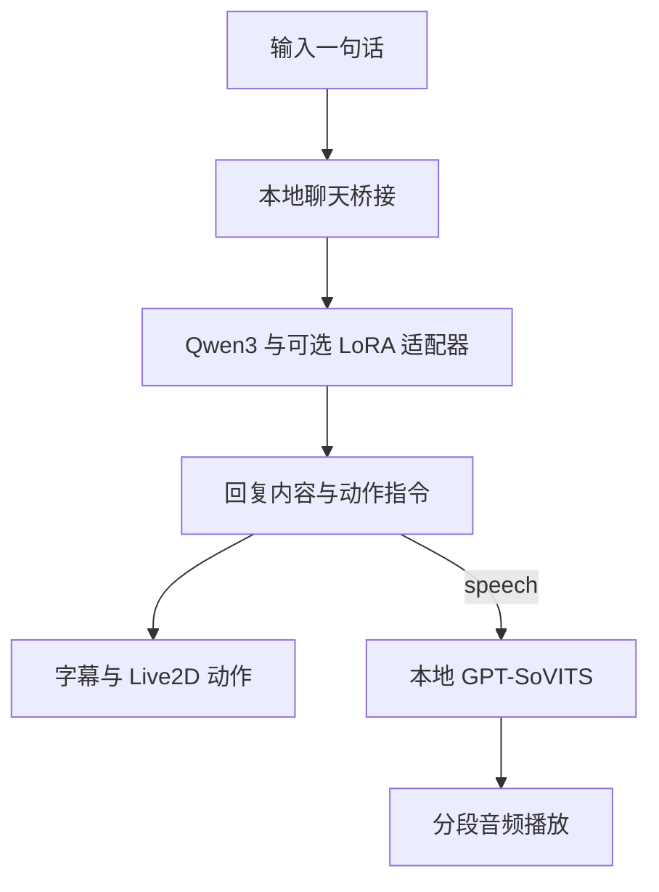

在[桌面部署与 AI 接入](/posts/live2d-inni-day2/)里，Inni 已经有了一个可以活动的桌面窗口。继续做下去，我开始更在意她怎么说话，以及说出来的声音是什么样的。

这一版的尝试放在 [inni-pet-2](https://github.com/swrited/inni-pet-2) 里：一边用 Qwen3 做角色语气微调，一边接入本地 GPT-SoVITS，让文字回复可以被念出来。

先说我自己的感受：**Qwen3 微调后，最明显的变化是说话语气；语音部分则让我很满意。** 我清洗了一些语音片段，之后生成的声音和原先的声音已经很像，生成速度在当时的使用中也挺快。

这些感受，也决定了这篇想记录的重点：角色的说话方式、声音素材，以及怎样把它们接进一个日常能用的桌宠。

## 先把一句回复拆开

桌宠收到一句回复以后，要做的事不止是在屏幕上显示文字。她可能需要念出一句话、显示字幕，再配一个点头或动耳朵的动作。

所以这个版本给模型约定了三个输出字段。下面是格式示意：

```json
{
  "speech": "我在呢，慢慢说。",
  "display": "我在呢，慢慢说。",
  "actions": [
    { "type": "gesture", "name": "earWiggle" }
  ]
}
```

`speech` 交给语音合成，`display` 用于文字展示，`actions` 交给已有的动作系统。这样，显示内容和朗读内容可以分别处理。例如使用其他语言说话时，界面仍可以显示中文翻译。

动作也有明确范围。模型可以返回 `nod`、`tilt`、`earWiggle` 等已定义的名称，本地服务会过滤不在允许列表里的动作。最终仍由桌宠程序执行这些动作。

整体上，一次互动经过下面这几步：



这一层约定很有用：换模型、调整语音、增加动作时，各部分都有一个相对清楚的接入口。

## Qwen3 微调主要改变了说话语气

这次用的基础模型是 **Qwen3-1.7B**。训练脚本采用 LoRA，在基础模型上训练一组适配器参数。训练后的适配器仍要和基础模型一起加载。[训练脚本](https://github.com/swrited/inni-pet-2/blob/main/finetune/train_lora.py)

角色要求写得比较具体：日常对话尽量短一些、自然一些；用户明确要求写内容或翻译时，就完成那件事；回复保持约定的 JSON 结构，动作名称也从现有列表里选。

对我而言，微调带来的直观变化主要是语气更贴近角色。至于能否稳定记住长期经历、处理更复杂的任务，还需要应用层的上下文和其他机制配合。

训练数据采用 `messages` 格式的 JSONL。一条样本里保留对话上下文，训练时将提示部分的标签设为 `-100`，只对最后一条 assistant 回复计算损失。模型需要学习的是：看到这一段上下文以后，Inni 应该怎样接话。

脚本中的默认配置如下，作为这次实现的记录：

| 项目 | 配置 |
|---|---|
| 基础模型 | `Qwen/Qwen3-1.7B` |
| LoRA | `r=16`，`alpha=32`，`dropout=0.05` |
| 训练精度 | BF16 |
| 训练轮数与学习率 | 4 轮，`2e-4` |
| 单设备批大小与梯度累积 | 1 与 8 |
| 最大序列长度 | 1024 tokens |

训练和推理都使用 Qwen3 聊天模板的 `enable_thinking=False`，让它直接生成供桌宠使用的回复。这是 Qwen3 的非思考模式开关；实际生成速度仍取决于运行设备、输入长度和输出长度。[Qwen3 官方说明](https://huggingface.co/Qwen/Qwen3-1.7B#switching-between-thinking-and-non-thinking-mode)

## 本地模型接进现有聊天接口

桌宠界面向本地桥接服务发送聊天请求，桥接再转给本地模型。`local_llm_server.py` 提供了 `/v1/chat/completions` 这样的接口，返回的结构可以继续沿用界面已有的处理逻辑。

整套启动脚本默认使用本地聊天后端，LLM 端口配置为 `18180`。如果单独运行 Python 服务，它自身的默认端口是 `18080`。排查连接问题时，这两个入口需要分清楚。[启动脚本](https://github.com/swrited/inni-pet-2/blob/main/start-all.js)

还有一个容易忽略的地方：**加载了 Qwen3，不等于已经加载了微调结果。** 单独运行服务时，`--adapter` 默认为空，只有传入适配器路径才会通过 PEFT 加载它。确认微调是否生效，要检查实际加载参数，不能只看接口返回的模型名称。[本地推理服务](https://github.com/swrited/inni-pet-2/blob/main/finetune/local_llm_server.py)

简单动作还留了一条更直接的路径。遇到“点头”“动动耳朵”一类短指令，服务可以直接返回预设动作和短回复，跳过模型生成。对于已经明确的动作请求，这样处理更直接，也减少了一次生成等待。

## 清洗语音片段以后 声音更接近预期

语音这部分，是我这次比较满意的地方。我先清洗了一些语音片段，再继续做声音实验。就当时听到的效果来说，生成语音和原先的声音很接近，出声速度也比较快。

接到应用里时，GPT-SoVITS 作为一个独立的本地服务运行。桌宠把要念的文字交给它，收到音频后再播放。语言模型负责生成回复，语音服务负责把这段回复变成声音，两边可以分别调整。

代码里的一个声音配置包含 GPT 权重、SoVITS 权重、参考音频，以及参考音频对应的文本。发起合成请求时，需要区分两组内容：

| 参数 | 用途 |
|---|---|
| `text`、`text_lang` | 这次准备念出来的文字及语言 |
| `ref_audio_path` | 参考音频的路径 |
| `prompt_text`、`prompt_lang` | 参考音频对应的文字及语言 |

其中 `prompt_text` 描述的是参考录音，不能直接替换成当前要朗读的回复。项目中的调用方式可以看 [local-tts.js](https://github.com/swrited/inni-pet-2/blob/main/local-tts.js)，参数定义对应 [GPT-SoVITS 官方 API](https://github.com/RVC-Boss/GPT-SoVITS/blob/main/api_v2.py)。

切换声音时，桥接会先切换服务使用的权重，再发起合成。这些请求放在串行队列里，避免多次合成同时切换共享的声音配置。

## 把等待时间和播放过程一起处理

声音生成得快，只是体验的一部分。回复比较长时，如果一定要等整段音频都准备好再播放，仍然会有明显的等待。

这个版本先按标点和长度拆分朗读文本。第一段生成以后开始播放，同时请求下一段音频，后面再按顺序接着播放。这里做的是**完整文字回复后的分段合成和预取**；当前本地聊天接口本身返回的是完整回复。

字幕也跟随音频片段显示。播放哪一段，就显示对应的字幕段落；它属于段落级配合，还没有做到逐字时间轴对齐。

播放中断同样需要处理。新的朗读开始时，会停止旧音频、取消仍在等待的请求，并通过一个递增的播放编号判断结果是否已经过期。这样，上一轮迟到的语音结果就不会又被接着播出来。[语音分段与播放实现](https://github.com/swrited/inni-pet-2/blob/main/index.html)

如果语音合成失败，界面仍保留文字回复。对桌宠来说，能让这一轮交流继续下去，比把所有功能绑成一个必须同时成功的步骤更实用。

## 接下来继续打磨的地方

这一版已经把角色回复、本地语音、字幕和动作放进了同一套交互流程。对我来说，最有价值的变化很具体：Inni 的语气有了调整，也可以用接近预期的声音回应我。

后续还可以继续打磨说话时的表现，包括把播放中的声音真正接到嘴型参数上，以及更自然的停顿和动作衔接。声音能播出来之后，这些细节会直接影响她待在桌面上的感觉。

复现时还需要准备自己的模型环境、LoRA 适配器、声音权重和参考音频，并调整启动脚本里的本机路径。公开仓库保存了应用和训练脚本，运行所需的大模型与声音资源需要另行配置。

我想继续沿着这个方向做下去：让 Inni 说话自然一些，回应及时一些，也让这个桌宠一点点接近日常愿意留在身边的小伙伴。
