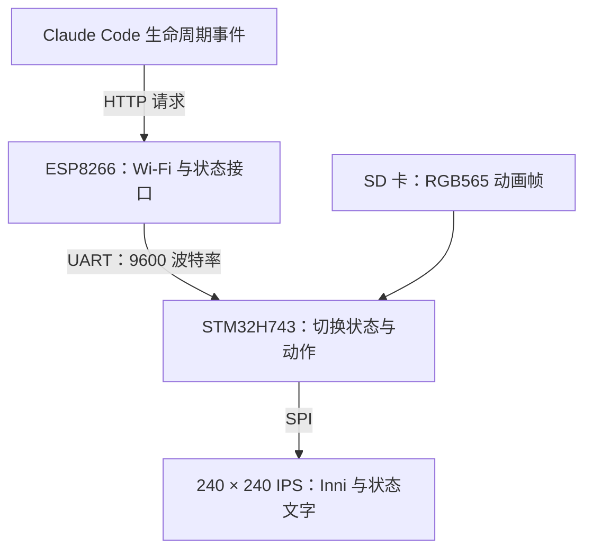

之前写过[把 Inni 搬上博客](/posts/inni-companion-guide/)，也记录过 Live2D 桌宠的制作。这一篇补记今年五月底做的另一个小项目：给 Inni 接上一块真实的小屏幕，让她在电脑旁显示 Claude 的工作状态。

这次的目标很具体：**我提交消息后，小屏进入 `Thinking`；Claude 这一轮回应结束，小屏回到 `Idle`。** 人物的动作也跟着切换。

电脑负责运行 Claude Code，ESP8266 负责接收状态，STM32 负责读 SD 卡、播放动画。一条原本只出现在终端里的状态，就这样变成了桌边能看到的小动作。

项目源码：[swrited/stm32h7_codexpet](https://github.com/swrited/stm32h7_codexpet)。仓库名里保留了 Codex，这次接入和视频演示使用的是 Claude Code。

## 先看一段实拍

<video controls playsinline preload="metadata" poster="/images/covers/stm32-claude-pet.webp" width="1280" height="720" style="width:100%;height:auto;border-radius:12px;">
  <source src="/videos/stm32-claude-pet/demo.mp4" type="video/mp4" />
  你的浏览器暂不支持内嵌视频，可以<a href="/videos/stm32-claude-pet/demo.mp4">打开演示视频</a>观看。
</video>

这段约 15 秒的视频把电脑上的 Claude Code、串口日志和小屏幕放在了同一个画面里。发出问题后，串口出现 `STATE:THINKING`，Inni 切换到等待动作；回应结束，再发送 `STATE:IDLE`。

这里的 `Thinking` 是我给“这一轮请求正在处理”取的显示名称。它通过程序事件切换，用来帮助我看状态，并不细分模型内部的推理与逐字输出阶段。

## 从电脑到小屏，经过哪几步

硬件用的是 STM32H743VGT6 开发板、240 × 240 的 SPI IPS 屏、SD 卡，以及 ESP8266／ESP-12F 模块。STM32 工程用 Keil MDK 编译，ESP8266 运行 NodeMCU Lua 固件。

整个链路可以画成这样：



这几个部件各自承担一件比较明确的事。网络问题可以先在 ESP8266 上查；串口有没有收到数据，可以单独观察；人物能不能动起来，则看 SD 卡和显示部分。调试时就能沿着这条链路逐段验证。

## SD 卡里存的，就是 Inni 的动作

这次需要一张 SD 卡来保存人物运动的帧。每种动作放在独立目录里，STM32 根据状态选择目录，再循环读取其中的文件。

```text
INNI050/
├─ I/              待机
│  ├─ I00.BIN
│  └─ ...
├─ WT/             等待／思考
│  ├─ WT00.BIN
│  └─ ...
├─ WV/             挥手
└─ RN/             跑动
```

当前固件使用的宠物帧尺寸是 **96 × 104**，编码为 **RGB565 大端原始数据**。每个像素占 2 字节，所以单帧数据量是：

```text
96 × 104 × 2 = 19,968 字节，约 19.5 KiB
```

素材先在电脑上处理好，透明区域合成到黑色背景，再存成 `.BIN` 帧。STM32 从 FAT32 文件系统读出这些字节，交给 LCD 显示。这使板子端的工作集中在读帧、计时和切换动作上。

源码里的状态对应关系如下：

| 显示状态 | 动作目录 | 当前播放方式 |
|---|---|---|
| `Idle` | `I` | 6 帧待机，帧间隔 180 ms |
| `Thinking` | `WT` | 5 帧等待，帧间隔 80 ms |
| `Answering` | `WV` | 4 帧挥手，往返播放，帧间隔 60 ms |
| `Busy` | `RN` | 6 帧跑动，帧间隔 40 ms |

`Thinking` 还有一个小调整：实际播放 `WT00 → WT01 → WT02 → WT03 → WT05`，跳过了 `WT04`。动作的观感，最后还是要放到小屏幕上看。

这里也补一个复现时需要注意的地方：**公开仓库目前包含固件和通信脚本，SD 卡里的动画帧没有一起提交，素材转换脚本也未包含在内。** 复现时需要另行准备符合尺寸、编码和目录约定的动画素材。

## 用一条串口消息切换动作

ESP8266 提供一个很小的 HTTP 接口，例如：

```text
http://<ESP_IP>/state?value=thinking
http://<ESP_IP>/state?value=idle
```

也支持 `/thinking`、`/idle` 这样的简写路径。收到请求后，Lua 脚本将状态转成串口文本：

```text
STATE:THINKING\r\n
STATE:IDLE\r\n
```

STM32 的 USART1 收到状态后，更新右侧文字，并切换到相应的动作目录。串口使用 **9600、8N1**；接收脚是 `PA10`，发送脚是 `PA9`。

在两个模块已正常供电、ESP8266 已连上 Wi-Fi 的前提下，先验证单向通信，需要连接这两条信号线：

```text
ESP8266 TX  →  STM32 PA10 / USART1_RX
ESP8266 GND ↔  STM32 GND
```

有了这一步，就可以先通过浏览器或脚本请求一个状态，观察串口日志与屏幕是否一起变化。HTTP 返回 `OK` 表示 ESP8266 已执行串口发送；当前协议还没有加入 STM32 的执行确认，所以最终仍要看屏幕是否响应。

## 让 Claude Code 自动通知小屏

手动切换成功以后，再把请求接到 Claude Code 的 hooks 上。原项目主要用了三个事件：

| Claude Code 事件 | 发给小屏的状态 | 在这个项目里的含义 |
|---|---|---|
| `UserPromptSubmit` | `thinking` | 我提交了一轮新请求，开始等待回应 |
| `Stop` | `idle` | 主代理这一轮回应已经结束 |
| `Notification` | `busy` | 有通知需要我注意，切换提醒动作 |

这段辅助脚本就能发送状态。把示例地址换成 ESP8266 在自己局域网中的地址即可：

```powershell
param(
    [ValidateSet('thinking', 'idle', 'answering', 'busy')]
    [string]$State = 'idle'
)

$deviceBaseUrl = 'http://192.168.1.50'

try {
    Invoke-WebRequest `
        -Uri "$deviceBaseUrl/state?value=$State" `
        -TimeoutSec 1 | Out-Null
} catch {
    # 小屏离线时，让当前命令结束，继续正常使用 Claude Code。
}
```

例如，将脚本保存为 `C:\pet\esp-state.ps1` 后，在 `UserPromptSubmit` 的 command hook 中执行：

```text
pwsh -NoProfile -File "C:\pet\esp-state.ps1" thinking
```

`Stop` 和 `Notification` 分别使用 `idle`、`busy` 参数。完整的配置结构可以参考项目 README 和 [Claude Code 官方 hooks 文档](https://code.claude.com/docs/en/hooks)。已有 hooks 的配置应合并保留。

视频里最主要的自动流程就是 **`Thinking → Idle`**。虽然固件和 HTTP 接口支持 `Answering`，当前示例没有把它自动绑定到“开始逐字输出回答”，可以先用手动请求测试挥手动作。

另外，`Notification` 包含权限请求、空闲提醒等多种通知，`Busy` 只是我选用的状态名和动作映射，不能据此判断模型一定正在忙。`Stop` 也表示这一轮主代理回应结束，而不是所有后台任务都完成。这些事件足够做一个直观的小外设，但需要按实际语义来理解。[事件说明](https://code.claude.com/docs/en/hooks#notification)

## 调试时，先把链路拆开

整理原项目记录时，有几处很值得保留。

**先认清 ESP8266 的固件。** 模块启动时出现 NodeMCU 和 Lua 提示，接下来就应该按 Lua 的方式配置。`lua: cannot open init.lua` 表示启动脚本还不存在；上传脚本并保存成 `init.lua` 后，才有上电自动联网和启动 HTTP 服务的流程。仓库里的两个 Python 工具用于通过串口上传 Lua 文件。

**串口不通时，先确认接线。** 原调试记录里既遇到过 PA10 接错位置，也遇到过 USB-TTL 的 TX 和 STM32 的 TX 同时接到 ESP8266 RX，导致 Lua 交互异常。先只保留一条可验证的发送链路，确认共地和引脚，再逐步接回去，排查会清楚得多。

**动画和文字按各自的节奏刷新。** 宠物需要连续换帧，状态文字只在状态变化时更新，计时数字也只刷新自己的小区域。把它们拆开，能减少整块 UI 重画造成的闪烁。

**看懂屏幕上的时间。** 这里的 `Time` 来自 `HAL_GetTick()`，显示的是开机后的运行时长，小时部分按 24 取模。它没有做联网校时。

这些细节的实现可以在 [主循环与状态切换](https://github.com/swrited/stm32h7_codexpet/blob/main/USER/main.c)、[SD 卡读取](https://github.com/swrited/stm32h7_codexpet/blob/main/HARDWARE/SDCARD/fat32_mini.c)和 [ESP8266 HTTP 桥接](https://github.com/swrited/stm32h7_codexpet/blob/main/esp8266_http_state_init.lua)里找到。配置网络时，记得填入自己设备使用的 Wi-Fi 信息。

## 接下来想让她做什么

这个版本已经把“程序事件 → 状态消息 → 人物动作”连了起来。我提交问题时，Inni 开始等待；这一轮回应结束，她回到待机。

接下来可以继续补上断线后的状态恢复、执行确认和更多动作，也可以给这块小屏做一个合适的外壳。这些都还属于后续方向。

对我来说，这个小项目也是把 AI 放进日常生活的一次尝试：先从一个看得见、能理解的小动作开始，让电脑上的工作状态在桌面上有一个可爱的落点。
