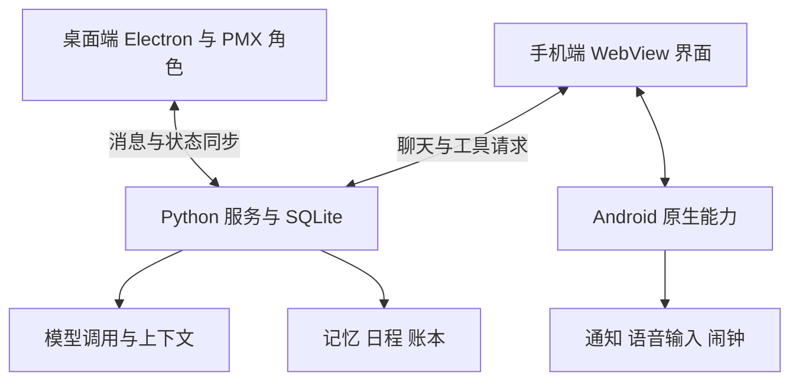

前面写了 Inni 的 [Live2D 桌面部署](/posts/live2d-inni-day2/)和[本地模型与语音](/posts/inni-local-model-and-voice/)。沿着桌宠这个方向，我还做了另一个项目：**周棋洛陪伴桌宠**。

它是一个独立的 3D 项目。角色表现使用现有 PMX 模型，桌面窗口由 Electron 承载，Three.js 负责渲染。之后我又继续加入手机端、对话记忆、日程和一些日常工具，让角色的回应逐渐能够接上具体的事情。

这篇整理的是截至 **2026 年 11 月 23 日的本地开发状态**。[公开仓库 zql_pet](https://github.com/swrited/zql_pet) 的最近提交仍在 8 月 31 日；后面介绍的部分记忆、日程、账本和 Android 扩展还在本地工作区，尚未全部同步。它们是当前实现的记录，不代表线上已经部署了全部功能。

## 让角色在三维空间里活动

桌面版的基础是一扇透明、无边框、置顶的 Electron 窗口。Three.js 使用透视相机，通过 `MMDLoader` 加载 PMX 模型，再根据模型的包围盒调整居中和落地位置。

角色在场景里前后移动时，屏幕上的大小会随透视变化。实现动作时，也需要同时考虑身体、镜头和地面的关系：身体俯下去，头部和手臂怎样跟着动；向前走，脚的位置怎样和位移配合。

当前动作主要由程序控制骨骼。呼吸、轻微摆动、眨眼和视线跟随作为持续的基础表现，再叠加点头、挥手等动作。步行还接入了 VMD 动画，通过 `AnimationMixer` 管理循环与过渡。

点击交互也和模型联系起来。代码用射线检测判断是否点中了角色，再按命中位置区分头部、上半身和下半身，触发不同反应；拖动时则移动桌宠窗口。这样，鼠标点到的区域和角色作出的反应能够对应起来。[公开版桌面渲染实现](https://github.com/swrited/zql_pet/blob/57bf3efbe4d6bd08b18b8a68a1a88dee41366d12/src/renderer.js)

衣柜负责切换不同 PMX 造型，并记住上一次的选择。本地还在调整昼夜外观切换，其中头发材质的着色依赖模型里的材质命名，需要逐个造型检查效果。

## 说话时让嘴型跟着声音变化

这一项目已经接上了音频驱动的嘴型。播放语音时，音频会接入 Web Audio 分析器，程序计算波形的 RMS 音量，再将平滑后的幅度映射到 PMX 的口型 morph 上。

声音变强，张嘴幅度增大；声音停下来，嘴也逐渐合上。这属于**音量驱动的口型表现**，目前还没有做到音素级对齐。不同口型的变化也仍是程序规则，需要模型本身提供相应的 morph。

当前语音入口可以连接云端服务，或显式启用的本地语音服务。合成端返回音频，播放端再分析它的幅度，驱动角色嘴型。这样，声音合成和角色表现有各自的处理环节，可以分别调整。[音频与嘴型代码](https://github.com/swrited/zql_pet/blob/57bf3efbe4d6bd08b18b8a68a1a88dee41366d12/src/renderer.js)

## 从桌面延伸到手机

后续的手机端使用 Java 编写的 Android WebView 外壳，承载网页界面，再通过桥接调用通知、语音输入和时钟等原生能力。桌面端继续负责 PMX 角色表现，两套界面通过服务端交换消息和状态。

服务端使用 Python 和 SQLite，保存事件及各类功能记录。桌面同步按游标拉取新事件，逐步吸收服务端的变化。这里已经有本地程序、网页、手机和服务端几部分，需要把它们各自负责的事情分清楚。

例如语音输入会优先尝试设备端识别，不支持时再走系统识别服务；闹钟则可以交给系统时钟，或由应用通过 `AlarmManager` 创建。这些能力仍受设备支持、权限和系统状态影响。

## 给记忆加上来源和时间

桌面版原本就有角色剧情检索，用来给对话补充角色背景。后续的服务端又加入了面向当前交流的记忆：近期在意什么、有什么事情值得之后再问一句，以及用户对旧信息作过哪些更正。

我给这些记忆保存了主题、摘要、原话证据、来源事件和更新时间。回复完成后，程序可以异步提取记忆；后台也会补处理尚未提取的用户事件。提取结果需要能对应到当前消息中的连续原文片段。

时间同样重要。如果一段旧对话的提取任务较晚才完成，它不能反过来覆盖用户刚刚作出的更正。当前代码按主题更新，并检查来源时间，尽量让后来明确表达的信息保留下来。

检索目前采用文本片段匹配和排序，将相关记录放回下一轮对话上下文。记忆保存在数据库中，模型在回答时读取它们。这样的设计便于后续更正、关闭或遗忘某条记录，但摘要是否准确，仍需要持续检查。

主动关心还有另外一层条件：通知开关、安静时段、频率和暂停状态都要参与判断。保存了“之后可以关心一下”的时间，并不意味着到了那个时刻就一定要打断用户。

## 把事项日期和提醒时间分开

日程里一个很容易混淆的地方，是“事情什么时候发生”和“什么时候提醒我”。

比如说“晚一点提醒我”，通常只是想挪动通知时间。原来的事项日期、标题和完成状态都应该保留。因此代码里将事项信息和提醒字段分开，`manage_schedule` 管理事项，`set_reminder` 调整通知。

修改之前还要检查真实事项 ID、来源消息和记录有没有被其他操作更新。如果用户已经发了新的指令，旧请求也不能在之后悄悄把它覆盖掉。后台发送提醒时，再通过稳定的事件标识和待发记录减少重复处理。

手机闹钟又多了一步。服务端把操作交给设备后，仍要等待设备端处理，手机上也需要经过用户确认。由 App 管理的闹钟在登记成功后，手机界面会显示登记结果；交给系统时钟的操作则只标记为已转交，仍需在系统时钟中检查是否保存成功。

这些检查解决的是不同层面的问题。服务端写入了一条提醒事件，也还需要手机端具备相应权限和投递条件，通知才能真正到达。

## 小账本需要能更正也能撤销

本地开发版还加了一个简单账本，先处理人民币收入和支出。金额按整数分保存，每条账目有自己的标识、版本号和操作记录。

新增账目时，程序用来源消息及其在消息中的位置识别这笔记录，避免一次请求重试后直接多出一笔。修改和删除则需要提供实际条目 ID 与预期版本；如果记录已经变了，旧请求会被拒绝。

撤销同样需要明确对象。“撤销刚才那笔”对应的是一次有 before/after 记录的操作。程序可以恢复修改前的值，或对新增项做软删除，同时保留操作历史。

如果这笔账后来又被修改，旧操作的撤销就不能直接覆盖新内容。这一点很重要：能够回退，要建立在知道自己回退的是哪一次变化的基础上。

目前账本的范围仍然比较小，退款、转账、借还款等语义还需要进一步设计。未来的预算也不能直接记成已经发生的支出。

## 让工具执行结果决定最终回复

当角色可以操作日程和账目以后，一句自然的回复背后就可能伴随数据库写入。这个版本把工具执行单独交给程序处理。

模型提出结构化的工具调用，执行器检查工具名、参数、当前消息来源和真实记录。涉及日程、提醒写入及账本修改时，还会发起独立的意图审核调用，核对这次操作是否符合用户的要求。

这项审核仍使用同一套模型适配层，它是一道额外检查。手机闹钟等设备操作则有自己的确认步骤，不能将它们概括成所有工具都需要用户再点一次确认。

执行器会保存操作标识、参数指纹和结果。如果某次执行的结果未知，就先停止自动重放，避免重复写入。最后生成回复时，也会检查工具回执；遇到失败或未获授权的操作，程序会替换掉可能虚构“已经办好”的说法。

角色可以保持自然的语气，但“记住了”“改好了”“提醒设好了”这些话，需要能对应到实际结果。

## 继续把这些部分磨合起来

这个项目从 3D 角色起步，逐渐有了两条并行的工作：一条是动作、声音和交互表现，另一条是记忆、提醒和日常操作。前者让角色的回应更生动，后者让回应能够接上生活里具体的事情。

当前还有不少需要继续磨合的地方，包括不同模型的动作与材质兼容、手机后台行为、记忆更正，以及执行失败时怎样清楚地告诉用户。日程等部分工具目前也仍围绕默认角色工作，还不能当作完善的多角色服务。

这篇先把已经写进本地实现的设计记录下来。后续再结合实际使用，继续调整这些功能之间的衔接，让角色说话自然一些，办事准确一些，也让这个陪伴项目更适合留在日常生活里。
